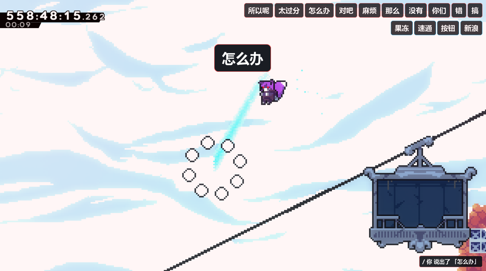
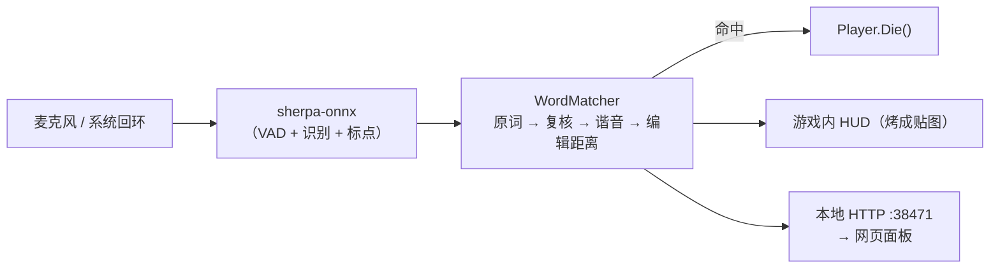

# VoiceKill 蔚蓝版

[](https://github.com/L-FLA5H/VoiceKill-Celeste/releases/latest)


> 「说到危险词就直接趋势」的蔚蓝整活 mod。
>
> 完全本地识别，不联网，不上传音频。


**别念右上角那几个词。**



## 声明

- 这是独立的第三方 Mod，与 Celeste、Everest 官方无关。
- 语音识别用 [sherpa-onnx](https://github.com/k2-fsa/sherpa-onnx)（Apache-2.0），
  三个模型随包分发（约 360MB），不需要另外下载，也不需要联网。
- 本仓库**不包含**任何第三方 Mod 的代码或资源。
- 词库收录、面板设计、测试与这堆说明由 [L_FLA5H](https://github.com/L-FLA5H) 折腾，
  代码开发由 AI 完成。哥们真的不会写代码。<br><br><br>
- 现在这个版本有非常多的明面上的和隐藏的不足或漏洞。我实在不想搞了所以先发一版有什么问题我能修再修吧饿啊

## **不想看太多字，只想直接开搞？** 见下方[安装](#安装)部分。

**目录** ｜ [它干什么](#它干什么) ・ [安装](#安装) ・ [第一次用](#第一次用) ・  [联机](#联机可选需要你自己组网) ・ [设置](#游戏内设置) ・ [常见问题](#常见问题-快速自检) ・ [已知局限](#已知局限) ・ [工作原理](#工作原理) ・ [关于](#关于)

## 它干什么

- **右上角一排危险词**，每 30 秒换一组
- **智能选词**：词会跟着你刚才聊的话题变，也可能挑你**刚说过**的词
- **踩雷动画**：红闪 0.4 秒 → 中间弹出 → 右下角播报

HUD 长这样（1920×1080，这里是 12 个词 → 每行 10 个换行）：


## 安装

### ⓿ 前置要求

| | |
| --- | --- |
| Celeste | 没蔚蓝你为什么要装这个？ |
| Everest | 任何能跑 Mod 的版本都行（本 Mod 只用到最基础的游戏内设置菜单） |
| 麦克风 | 没麦克风你为什么要装这个？ |

> 对电脑配置基本没要求，模型跑在本机 CPU 上，不吃显卡。

### ① 解压到 Mods

压缩包里只有一个 `VoiceKill` 文件夹，**把它整个解压/拖进 Mods 就行**：

```
把压缩包里的 VoiceKill 文件夹 → 拖到 <Celeste 安装目录>\Mods\
```

**解压后的目录应该长这样**，照这个对一下：

```
<Celeste 安装目录>\Mods\VoiceKill\
├── everest.yaml
├── voicekill.cfg
├── 词库.txt
├── bin\
│   ├── VoiceKill.dll
│   └── ...（识别引擎、音频库）
└── models\
    ├── zipformer-bilingual-small-int8\
    ├── sensevoice-review-int8\
    └── ...
```

> 常见的装错方式：<br>
> ① **把 zip 直接丢进 `Mods\`** —— 游戏能看见 Mod，但会报「原生库加载失败」，因为 zip 里的 dll 没有实体路径。<br>
> ② 把压缩包**解压成一堆文件**丢进 `Mods\` 根目录 —— `everest.yaml` 跑到 Mods 根上，Everest 看不懂。<br>
> ③ 解压进已经存在的 `VoiceKill` 文件夹，变成 `Mods\VoiceKill\VoiceKill\` —— 新版会自动往下找一层，但最好摆正。<br>
> ④ zip 和文件夹同时留在 Mods 里 —— 日志会出现 `already discovered; keeping the first container`，两个容器抢同一份配置。

> 本 Mod **推荐解压安装，不要直接丢 zip**：模型有 360MB，
> zip 加载的 Mod 会被 Everest 解压到 `Mods\Cache\`，出问题时很难看清版本。

### ② 开游戏确认

主菜单 → **MODS** → 列表里能看到 `VoiceKill` 且状态是 `Enabled`。

### ③ 进关卡

随便进一张图，右上角出现一排禁词就说明好了。

第一次进图会卡 1~3 秒 —— 在加载识别模型，正常。

## 第一次用

游戏内设置 → VoiceKill → 点第一项 **「打开控制面板」**，会弹浏览器
（也可以手动访问 `http://localhost:38471/panel`）。

面板从上到下就是三步：

1. **选麦克风** —— 下面有根电平条，说话时会跳；一直是「很安静」就换个设备
2. **选玩法** —— 单人自己玩 / 我开房 / 加入别人的房
3. 完事，回去跑图


## 联机（可选，需要你自己组网）

本 Mod 只负责「两台机器能互相访问」之后的同步，
不提供中转服务器，也不会自动穿越 NAT，即你需要使用Radmin VPN等软件才能联机。我甚至把自己的服务器搬出来过试图做这个联机功能，但效果实在不尽人意。

| 你们的情况 | 要做什么 |
| --- | --- |
| 同一个 WiFi / 路由器 | 什么都不用装，填主机的内网 IP（`192.168.x.x`）。真的有人符合这个条件的吗？ |
| 不在同一个地方 | **自己组网**：Radmin VPN / Tailscale / ZeroTier，或者自搭 frp、内网穿透，填它给你的 IP |
| 一点网络都不想动 | 用下面的「离线同步」 |

### 「地址」那一栏到底填什么

填**你自己这台电脑能访问到房主电脑的那个地址**。不是房主的公网 IP，也不是 frp 配置里复制下来的代码。

| 你看到的房主信息 | 你该填 |
| --- | --- |
| 房主面板显示 `192.168.1.51` | `192.168.1.51` |
| 穿透服务给你的 `xxx.frp.one:19747` | `xxx.frp.one:19747` |
| Radmin / Tailscale 给你的 `26.12.34.56` | `26.12.34.56` |

**端口**：不写就自动补 `38471`；不是默认端口（穿透出来的基本都不是）就写成 `域名:端口`。`http://` 前缀可加可不加，多打了也会被自动去掉。

填完别急着点「加入」，先点旁边的 **「测试连接」**：连上会显示 ✓ 和最终用的地址，连不上会直接告诉你原因（超时 / 对方拒绝 / 域名不存在 / 口令不一致）。地址输入框下面还会实时显示「将连接：http://...」，能一眼看出端口补对没有。


### 天堂中的麻烦？不会组网？你可以使用一个下策。

将mod的声音来源改成「抓桌面音频」（抓 OOPZ / QQ 通话里所有人），


再勾选「离线同步」，这样mod会抓取整个桌面音频。
代价：多人抢话时识别会糊，而且词表退化成随机 + 高频词（离线同步下智能选词会关掉）。

而且本功能暂时没有测试数据，如有bug请提issue。

## 游戏内设置

只有三项：

```
打开控制面板（推荐用这个设置）    ← 按钮
总开关
备用设置（面板打不开时用）▽      ← 子菜单
```

其余设置全在网页面板里。备用设置是「面板打不开」时的兜底，和面板用的是同一份数据。

## 常见问题 快速自检

### ① 说话没反应

**1. 面板里选对麦克风了吗？**

面板第一行有个下拉框和一根电平条。对着麦说话，条会跳；一直是「很安静」就换一个设备。

**2. 选的是「抓桌面音频」吗？**

开了这个开关，Mod 听的就是系统输出（通话里所有人的声音），不再听你自己的麦克风。
只想自己玩就切回「麦克风」。

### ② 面板打不开

浏览器直接输 `http://localhost:38471/panel`。

还是不行就打开 `http://localhost:38471/diag` —— 这是纯文本诊断页，不跑脚本：

- 显示一大段 `OK {...}` → 服务正常，问题在页面；页面底部会有一条红字把错误写出来
- 打不开 → 服务没起来，去看游戏日志里 `[VoiceKill]` 开头的行

> 端口被别的程序占了也没关系，Mod 会自动往后试 38472~38478。

### ③ 面板顶部红条写「看起来是直接把 zip 丢进 Mods 了」

**这个 Mod 不能直接丢 zip 用。**

识别引擎是原生库（`.dll`），必须从真实文件加载；zip 里的 Mod 是内存加载的，
读不到那些文件，整个功能会直接停用。

把 zip **解压成文件夹**：

```
Mods\VoiceKill\bin\VoiceKill.dll
Mods\VoiceKill\models\...
```

> 顺手检查一下 `Mods\` 里有没有**同名的 zip 和文件夹同时存在**，
> 那会变成两个 Mod 抢同一份配置（日志里能看到 `_dir_VoiceKill`）。只留文件夹。

### ④ 改了设置不生效 / 行为跟说明对不上

**删掉 `Mods\Cache\` 里带 `VoiceKill` 的文件，重启游戏。**

Everest 会缓存 Mod 的主程序集，不删缓存会一直跑旧版本。

### ⑤ 开房时显示的 IP 是 `169.254.x.x`，或者提示「没检测到可用的内网 IP」

`169.254.x.x` 是**没拿到路由器分配地址**时的临时地址（也叫 APIPA），
别人是连不上的 —— 大概率是这台机器没连 WiFi / 没插网线，或者只有虚拟网卡。

先把网络连上，或者先把虚拟局域网（Radmin / Tailscale）连好，再回面板看。

### ⑥ 客机的词粘成一坨（`1t2t3`），或者两边不是同一组

**两边版本不一致。** 0.9.6 之前的版本在解析主机的词表时把分隔符吃掉了，
Tab 变成字母 `t`，所以 8 个词会显示成一个 `1t2t3...`。

双方都更新到最新版即可。新版主机还会额外广播「这一轮有几个词」，
如果你的版本比房主旧，面板会直接提示，而不是让你盯着怪词发呆。

另外：读档 / 换关（含 SpeedrunTool 保存状态）之后，客机会立刻重新对齐一次词，
不用等房主下次换词。

### ⑦ 面板顶部有一条红条

上面写什么就改什么（通常是「模型目录不存在」或者「原生库加载失败」），改完重启游戏。
装成 zip 的话红条会直接告诉你「解压成文件夹」。好吧我知道把这样的问题交给用户自己解决有点蠢但我实在是心有余而力不足。orz

### ⑧ 进图卡好几秒

在加载识别模型，1~3 秒正常，之后就不卡了。

## 已知局限

- **联机功能缺少完备的测试**，本人实在找不到很好的稳定的能找到很多打围栏的朋友一起来狠狠测试的方法。有问题请提issue。我尽力
- **单字地狱词很容易误杀**（「我」「你」「是」）—— 这是故意的，那一组就是拿来杀人的；
  嫌狠就把「高频词数」调小，或者去词库面板把某几个词关掉
- **英文能判，但不如中文稳**，小模型对英文的容错差一些
- **跨地区联机需要你自己组网**，即使用Radmin VPN等软件。本 Mod 不做 Nat 穿透，因为实在做不出来，手头捏了个服务器但没有用武之地，非常憋憋。

## 工作原理

整个流程都在本机完成，音频不出网：



- **识别**：sherpa-onnx 的 zipformer 模型，16kHz 单声道，边说边出中间结果
- **匹配**：先比原词，再比归一化后的，再比谐音，最后用编辑距离兜底
- **HUD**：中文画不进 Celeste 的位图字体，所以用 GDI+ 把词烤成贴图再贴上去
- **面板**：一个只监听 `127.0.0.1` 的小 HTTP 服务，浏览器打开就能改设置

### 延迟（实测）

同一段音频、同一个危险词，判定发生在音频第几秒：

| 版本 | 判定时刻 | 改了什么 |
| --- | --- | --- |
| v0.1.1 | 6.60s | 静音被丢弃，端点永远不触发，只能等 4 秒强制截断 |
| v0.1.2 | 1.72s | 静音也喂进识别器，端点正常；0.35 秒静音就结算 |
| v0.1.2 + 边说边判 | **1.40s** | 句子没说完就命中 |

## 进阶

如果你只是普通用户，这部分可以不看。好吧说得好像上边那一大坨就值得看了似的

<details>
<summary>自己编译</summary>

需要 .NET 8 SDK。仓库里有两个项目：

```bash
# 核心库（识别 + 匹配 + 词库），不依赖 Celeste
dotnet build VoiceKill.Core -c Release

# 游戏内 Mod
cd VoiceKill/Source
dotnet build -c Release
```

编译产物在 `VoiceKill/bin/`，把它和 `everest.yaml` 一起放进 `Mods\VoiceKill\`。

命令行版（不进游戏就能测识别）：

```bash
dotnet run --project Tools/VoiceKill.Cli -- --asr "某个音频.wav"
```

</details>

## 关于

### 致谢

- **Everest** —— 蔚蓝的 Mod 加载器与 API，没有它什么都跑不起来
- **[sherpa-onnx](https://github.com/k2-fsa/sherpa-onnx)** —— 本机的语音识别引擎，Apache-2.0
- **MC 版 voicekill** —— 高频地狱词那一组的来源，也是这个系列的开头

### 许可

[MIT](LICENSE) © L_FLA5H
